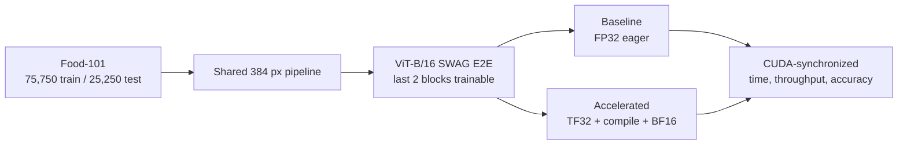

# Training acceleration: a controlled PyTorch experiment

This repository turns an exploratory notebook into a reproducible A/B
benchmark. Both profiles use the same dataset, model initialization, trainable
layers, augmentations, optimizer, scheduler, loss, batch size, worker count,
seed, and evaluation loop. Only the acceleration switches differ.

The repository includes a rendered
[`controlled_experiment.ipynb`](notebooks/controlled_experiment.ipynb) and a
command-line runner for unattended measurements.

> **Result status:** the original notebooks contain a **2.06x historical
> observation**: 27.71 minutes versus 13.43 minutes for the first epoch. That
> comparison was not controlled, so it is presented as motivation rather than
> causal proof. The benchmark runner records controlled results separately.

## What is being compared?

| Setting | Baseline | Accelerated |
|---|---|---|
| `torch.set_float32_matmul_precision` | `"highest"` | `"high"` |
| CUDA/cuDNN TF32 | disabled | enabled |
| `torch.compile` | disabled | enabled |
| autocast | disabled (FP32) | enabled (BF16 by default) |
| Everything else | identical | identical |



The benchmark launches every trial in a new process, alternates profile order
across repeats, synchronizes CUDA around timed regions, and reports cold-start
and steady-state speedups separately.

## Dataset: Food-101

[Food-101](https://data.vision.ee.ethz.ch/cvl/datasets_extra/food-101/) is a
fine-grained food-recognition dataset with:

- 101 dish categories and 1,000 RGB photographs per category;
- 101,000 images total;
- 750 training images per class, or 75,750 training examples;
- 250 test images per class, or 25,250 test examples;
- intentionally noisy training images and manually cleaned test images.

The shared preprocessing follows the experiment:

1. resize to 384 x 384;
2. apply `TrivialAugmentWide` and random horizontal flip during training;
3. convert pixels to tensors in `[0, 1]`;
4. normalize with ImageNet mean `(0.485, 0.456, 0.406)` and standard deviation
   `(0.229, 0.224, 0.225)`.

The loader accepts either the notebook's existing structure:

```text
DATA_ROOT/
├── train/
│   ├── apple_pie/
│   └── ... 100 more classes
└── test/
    ├── apple_pie/
    └── ... 100 more classes
```

or the official `torchvision.datasets.Food101` download.

## Model: ViT-B/16 with SWAG E2E weights

The model is
[`torchvision.models.vit_b_16`](https://docs.pytorch.org/vision/0.24/models/generated/torchvision.models.vit_b_16.html)
initialized with `ViT_B_16_Weights.IMAGENET1K_SWAG_E2E_V1`. These weights use
384 x 384 inputs.

Each image becomes `(384 / 16)^2 = 576` non-overlapping patches. A learned class
token is added, giving a sequence length of 577. Each token has width 768 and
passes through 12 Transformer encoder blocks.

The repository freezes the pretrained backbone, then unfreezes encoder blocks
10 and 11 plus the final encoder layer normalization and replaces the
ImageNet-1K head with a 101-class linear layer:

- total parameters after replacing the head: **86,168,165**;
- trainable parameters: **14,254,949**;
- frozen parameters: **71,913,216**.

This is transfer learning rather than full fine-tuning. It preserves the same
compute-heavy forward pass while greatly reducing gradient and optimizer-state
work.

## Why this workload can become much faster

An epoch is not one indivisible operation. Its wall time is approximately

```math
T_{epoch}=T_{input}+T_{H2D}+T_{forward}+T_{backward}+T_{optimizer}+T_{eval}.
```

The acceleration techniques act mainly on the forward and backward terms.
They cannot remove image decoding, augmentation, host-to-device transfer, or
evaluation. This is why the repository keeps the input pipeline identical in
both profiles: otherwise a faster DataLoader could be mistaken for faster
matrix arithmetic.

The experiment is especially suitable for GPU acceleration because a Vision
Transformer is dominated by large matrix multiplications. Those operations
map well to NVIDIA Tensor Cores, and their surrounding elementwise operations
provide opportunities for compiler fusion.

### What ViT-B/16 computes

For an image `x` with shape `3 x 384 x 384`, patch size `P=16`, and embedding
width `D=768`, the patch projection produces

```math
N=\left(\frac{384}{16}\right)^2=24^2=576
```

image tokens. After adding the learned class token, the encoder processes

```math
X\in R^{577\times768}.
```

ViT-B has 12 attention heads. Each head has width

```math
d_h=\frac{768}{12}=64.
```

For every encoder block, attention constructs queries, keys, and values:

```math
Q=XW_Q,\qquad K=XW_K,\qquad V=XW_V,
```

then computes

```math
A=\mathrm{softmax}\left(\frac{QK^T}{\sqrt{d_h}}\right),
\qquad Y=AV.
```

The `Q`, `K`, and `V` projections, attention products, output projection, and
MLP layers are GEMMs—general matrix multiplications. For sequence length `N`
and embedding width `D`, attention contains an `O(N^2D)` term, while the
projections and MLP contain `O(ND^2)` terms.

Moving from the usual 224-pixel ViT input to 384 pixels increases the sequence
from 197 to 577 tokens including the class token. The attention matrix alone
grows by approximately

```math
\left(\frac{577}{197}\right)^2\approx8.58.
```

That makes this 384-pixel experiment substantially more compute- and
memory-intensive—and therefore a strong candidate for reduced-precision
Tensor Core execution.

### Why only the final two encoder blocks are trained

Write the network as frozen early blocks followed by trainable late blocks:

```math
h=f_{frozen}(x;\theta_f),
\qquad \hat y=f_{trainable}(h;\theta_t).
```

The optimizer needs

```math
\nabla_{\theta_t}\mathcal L,
```

but not the complementary gradient $\nabla_{\theta_f}\mathcal L$. Because
neither the input images nor the frozen
parameters require gradients, PyTorch does not need to construct a backward
graph through those early blocks. Their forward computation still happens,
but their activations do not need to be retained for parameter-gradient
calculation.

This policy makes 14.25M parameters trainable instead of 86.17M. It reduces
backward work, gradient memory, and Adagrad state while retaining the semantic
features learned by SWAG/ImageNet pretraining.

## Technique 1: high float32 matmul precision and TF32

### Numerical representation

IEEE FP32 has one sign bit, eight exponent bits, and 23 stored fraction bits.
Near one, adjacent representable FP32 values are separated by roughly

```math
2^{-23}\approx1.19\times10^{-7}.
```

NVIDIA TensorFloat-32 keeps FP32's eight-bit exponent but uses a ten-bit
fraction for multiplication. Its spacing near one is approximately

```math
2^{-10}\approx9.77\times10^{-4}.
```

For a dot product, the hardware behaves conceptually like

```math
s=\sum_i
\mathrm{round}_{TF32}(a_i)
\mathrm{round}_{TF32}(b_i),
```

while accumulating the products in FP32. Thus TF32 keeps FP32-like range and
FP32 accumulation, but accepts less precise multiplicands.

### PyTorch logic

The accelerated profile enables

```python
torch.set_float32_matmul_precision("high")
torch.backends.cuda.matmul.allow_tf32 = True
torch.backends.cudnn.allow_tf32 = True
```

The `"high"` policy allows PyTorch to use a faster internal representation for
float32 matrix multiplication when suitable hardware exists. Depending on the
backend, this can mean TF32 or a bfloat16-based decomposition. Input and output
tensors still appear as FP32; the policy changes the internal multiplication.
cuDNN convolution permission is separate, so it is enabled explicitly.

The baseline uses `"highest"` and disables both TF32 flags. Therefore its
float32 matrix products retain full FP32 internal precision.

### Why performance improves

Tensor Cores execute eligible TF32 products at much higher throughput than
traditional FP32 CUDA cores. ViT repeatedly multiplies large dense matrices,
so a large fraction of its compute can use that path.

TF32 helps only operations that remain FP32. When BF16 autocast already selects
BF16 for a layer, TF32 does not accelerate that same multiplication again.
Consequently TF32 and AMP overlap rather than producing multiplicative gains.

## Technique 2: BF16 automatic mixed precision

### Why training does not use one dtype everywhere

Different operations have different numerical sensitivity. Matrix
multiplications and convolutions often tolerate reduced precision, while
normalization, reductions, exponentials, and loss calculations may benefit
from FP32 range or accuracy.

Autocast chooses the dtype by operation:

```python
with torch.autocast(device_type="cuda", dtype=torch.bfloat16):
    logits = model(images)
    loss = loss_function(logits, targets)
```

It does **not** permanently convert every model parameter to BF16. Master
parameters and optimizer state remain FP32; eligible forward/backward kernels
receive BF16 operands, while sensitive operations remain FP32.

### BF16 versus FP32 and FP16

| Format | Sign bits | Exponent bits | Fraction bits | Main property |
|---|---|---|---|---|
| FP32 | 1 | 8 | 23 | high precision and wide range |
| TF32 multiply | 1 | 8 | 10 | FP32-like range, Tensor Core matmul |
| BF16 | 1 | 8 | 7 | FP32-like range, low precision |
| FP16 | 1 | 5 | 10 | more precision than BF16, much less range |

BF16 spacing near one is approximately

```math
2^{-7}=0.0078125,
```

or about 0.78%. That seems coarse, but neural-network optimization is noisy,
and BF16 products are normally accumulated in FP32. Crucially, BF16 retains
FP32's exponent width, so very small and very large values are less likely to
underflow or overflow than with FP16.

### Why no gradient scaler is used for BF16

FP16 has only five exponent bits. Small gradients may round to zero. Gradient
scaling addresses that by replacing the loss with

```math
\widetilde{\mathcal L}=S\mathcal L,
```

which produces scaled gradients

```math
\nabla\widetilde{\mathcal L}=S\nabla\mathcal L.
```

Before the optimizer update, gradients are divided by `S`. BF16 already has
FP32-like range and generally does not require this mechanism, so the default
BF16 experiment disables the scaler. The optional FP16 path enables it.

### Why performance improves

BF16 activations require approximately half the storage of FP32 activations.
That can reduce:

- global-memory traffic;
- cache pressure;
- saved-activation memory during backpropagation;
- Tensor Core execution time for eligible matrix operations.

The benchmark deliberately keeps batch size at 128 in both profiles. Allowing
BF16 to use a larger batch would be a valid practical optimization, but it
would no longer isolate the effect of precision and compilation.

## Technique 3: `torch.compile`

### The cost of eager execution

In eager PyTorch, Python dispatches operations one by one. A simplified block
might execute as

```text
launch layer_norm → write temporary
launch linear     → read/write temporary
launch bias       → read/write temporary
launch GELU       → read/write temporary
launch dropout    → read/write temporary
```

For each operation, total time includes more than arithmetic:

```math
T_{op}=T_{Python}+T_{dispatch}+T_{launch}+T_{memory}+T_{compute}.
```

Small elementwise operations may spend more time in launch and memory overhead
than in mathematical work.

### Graph capture and generated kernels

`torch.compile` uses TorchDynamo to capture compatible Python/PyTorch regions,
AOTAutograd to expose training graphs, and Inductor to generate optimized
kernels. With a larger view of the graph, the compiler can:

- fuse adjacent pointwise and reduction operations;
- remove repeated Python and dispatcher overhead;
- reduce intermediate tensor reads and writes;
- reduce the number of GPU kernel launches;
- specialize code for known shapes, strides, devices, and dtypes.

The earlier sequence can become conceptually

```text
launch fused(layer_norm + linear + bias + GELU + dropout)
```

where fewer intermediate values travel through global GPU memory.

### Compilation is an investment

The first compatible input pays capture and code-generation costs:

```math
T_{cold}=T_{capture}+T_{codegen}+T_{compile}+T_{execution}.
```

Later executions reuse cached code while their guards remain valid:

```math
T_{steady}\approx T_{compiled\ execution}.
```

This is why the repository does not hide the first epoch. It reports both
cold-start and steady-state results. Fixed 384 x 384 inputs and a fixed batch
size reduce recompilation, although the smaller final batch can still require
another specialization.

The original notebook set `torch._dynamo.config.suppress_errors=True`. That can
silently fall back to eager execution and weaken the claim that compilation
was measured. This repository lets compilation fail visibly instead.

## How the techniques interact

The combined speedup is not

```math
S_{total}=S_{TF32}\times S_{AMP}\times S_{compile}.
```

The techniques accelerate overlapping portions of the workload:

- BF16 autocast moves many GEMMs away from FP32, reducing the set that TF32 can
  accelerate;
- `torch.compile` can fuse casts introduced by autocast with neighboring work;
- compilation reduces launch/memory overhead, while BF16/TF32 primarily reduce
  arithmetic and bandwidth cost;
- none of them accelerates all CPU data preparation.

If fraction `p` of epoch time is accelerated by factor `s`, Amdahl's law gives

```math
S=\frac{1}{(1-p)+p/s}.
```

For example, if GPU-eligible work is 75% of the epoch and becomes 4x faster,
the total speedup is only

```math
S=\frac{1}{0.25+0.75/4}\approx2.29.
```

This explains both why a roughly 2x end-to-end result is plausible and why a
4x Tensor Core throughput specification does not imply a 4x training run.

## Optimization remains mathematically identical

The baseline and accelerated profiles use the same objective and update rule.
Only the numerical approximation and execution strategy change.

### Label-smoothed cross-entropy

For `K=101`, true class `y`, and smoothing `epsilon=0.2`, the target is

```math
q_k=(1-\epsilon)I(k=y)+\frac{\epsilon}{K}.
```

Here, `I(k=y)` is the indicator: it equals one for the true class and zero for
every other class.

The loss is

```math
\mathcal L=-\sum_{k=1}^{K}q_k\log p_k.
```

Smoothing discourages extreme confidence and can improve transfer-learning
generalization.

### Adagrad

For gradient `g_t`, the elementwise squared-gradient accumulator is

```math
G_t=G_{t-1}+g_t^2,
```

and the parameter update is

```math
\theta_{t+1}=\theta_t-
\frac{\eta_t}{\sqrt{G_t}+\delta}g_t.
```

Coordinates with a long history of large gradients receive smaller effective
steps.

### Cosine learning-rate decay

For a run of `T` epochs,

```math
\eta_t=\eta_{min}+\frac{1}{2}(\eta_{max}-\eta_{min})
\left(1+\cos\frac{\pi t}{T}\right).
```

Holding these rules constant matters: changing the optimizer or schedule could
alter both convergence and runtime and would confound the acceleration claim.

## What “same result” should mean

Reduced precision changes rounding. If `fl(x)` denotes a floating-point
operation, then approximately

```math
\mathrm{fl}(x\circ y)=(x\circ y)(1+\delta),
\qquad |\delta|\le u,
```

where unit roundoff `u` depends on the format. Small differences accumulate,
changing later gradients and parameter values. Bitwise-identical checkpoints
are therefore not expected.

The correct criterion is statistical and task-level: the accelerated profile
should preserve Top-1/Top-5 accuracy within a declared tolerance while reducing
time and/or increasing images per second. The repository records both speed
and accuracy so one cannot be reported without the other.

## Minimal reproduction interface

The theoretical comparison above is implemented by one command after the
project dependencies are available:

```bash
food101-benchmark --data-root data --download --epochs 3 --repeats 2 --discard-first-epochs 1
```

Installation details are intentionally kept out of the experiment narrative;
the pinned environment is declared in `pyproject.toml` and `requirements.txt`.

## Measurement evidence

Each trial writes `result.json`; the benchmark also writes `benchmark.json`:

```text
artifacts/<UTC timestamp>-benchmark/
├── repeat-1/
│   ├── baseline/result.json
│   └── accelerated/result.json
├── repeat-2/
│   ├── accelerated/result.json
│   └── baseline/result.json
└── benchmark.json
```

Recorded evidence includes:

- complete configuration and every acceleration switch;
- Python, PyTorch, torchvision, CUDA and cuDNN versions;
- GPU name, compute capability, BF16 support and peak allocated memory;
- dataset sizes and source adapter;
- parameter counts and model-weight identity;
- per-epoch loss, Top-1, Top-5, train/evaluation seconds and throughput;
- cold and steady-state mean/std plus baseline-to-accelerated speedups.

CUDA synchronization occurs before and after each phase. Without it, Python's
timer can stop while asynchronous GPU kernels are still running and report an
incorrectly short duration.

## Historical notebook observation

The source notebooks recorded the following first epochs:

| Run | Time | Test Top-1 ACC | Nominal speedup |
|---|---|---|---|
|  ViT run | 27.71 min | 87.65% | 1.00x |
| accelerated run | 13.43 min | 87.04% | **2.06x** |

The JSON transcription is in
[`results/original-notebook-observation.json`](results/original-notebook-observation.json).
The result is plausible but confounded: data augmentations, worker settings,
debug synchronization, PyTorch environment, learning rate, and gradient
clipping differ. Therefore this repository treats 2.06x as the hypothesis to
test—not the conclusion.

## Interpreting a result

The two primary ratios are

```text
cold speedup   = mean baseline epoch time / mean accelerated epoch time
steady speedup = mean baseline steady epoch time / mean accelerated steady epoch time
```

The cold number includes graph compilation. The steady number removes the
configured number of initial epochs independently from every run. Report both;
discarding compilation cost without saying so is misleading.

Check accuracy as well as speed. A faster run is useful only if its final
Top-1/Top-5 values remain acceptably close to the FP32 baseline. Exact equality
is not expected because reduced precision changes floating-point rounding and
therefore the optimization path.

## Repository map

```text
.
├── src/food101_accel/
│   ├── benchmark.py       # isolated and alternated A/B trials
│   ├── config.py          # shared invariants and profile switches
│   ├── data.py            # Food-101 and deterministic loader setup
│   ├── engine.py          # synchronized training/evaluation loop
│   ├── model.py           # ViT-B/16 partial fine-tuning
│   ├── reporting.py       # cold/steady aggregation and speedups
│   ├── runtime.py         # TF32, AMP, compilation and environment capture
│   └── train.py           # single-profile CLI
├── docs/
│   ├── benchmarking.md    # experimental protocol and claim checklist
│   └── techniques.md      # mathematical/performance explanation
├── notebooks/
│   └── controlled_experiment.ipynb  # interactive presentation layer
├── results/               # historical evidence and provenance
└── tests/                 # dependency-free tests for config/reporting logic
```

## Methodological limits

- A 2x speedup is hardware- and workload-dependent, not guaranteed.
- `torch.compile` needs a warm-up and can recompile if input shapes change.
- This benchmark uses fixed 384 x 384 shapes to avoid shape-driven recompiles.
- The official test split is evaluated for comparability with the notebook.
  Repeated tuning on that split makes the best epoch a biased test estimate. A
  separate validation split and a single final test evaluation are required
  for an unbiased model-quality study.
- One seed is sufficient for a timing demonstration but weak evidence for
  accuracy; model-quality conclusions require multiple seeds.
- No GPU name was recorded in the notebook, so its timing cannot be reproduced
  exactly from the saved artifact alone.

Further detail is available in [the mathematical explanation](docs/techniques.md)
and [the benchmark protocol](docs/benchmarking.md).

## References

- [PyTorch 2.9 `torch.set_float32_matmul_precision`](https://docs.pytorch.org/docs/2.9/generated/torch.set_float32_matmul_precision.html)
- [PyTorch 2.9 `torch.compile`](https://docs.pytorch.org/docs/2.9/generated/torch.compile.html)
- [PyTorch 2.9 automatic mixed precision](https://docs.pytorch.org/docs/2.9/amp.html)
- [torchvision 0.24 ViT-B/16 and SWAG E2E weights](https://docs.pytorch.org/vision/0.24/models/generated/torchvision.models.vit_b_16.html)
- [Food-101 official dataset page and paper](https://data.vision.ee.ethz.ch/cvl/datasets_extra/food-101/)
